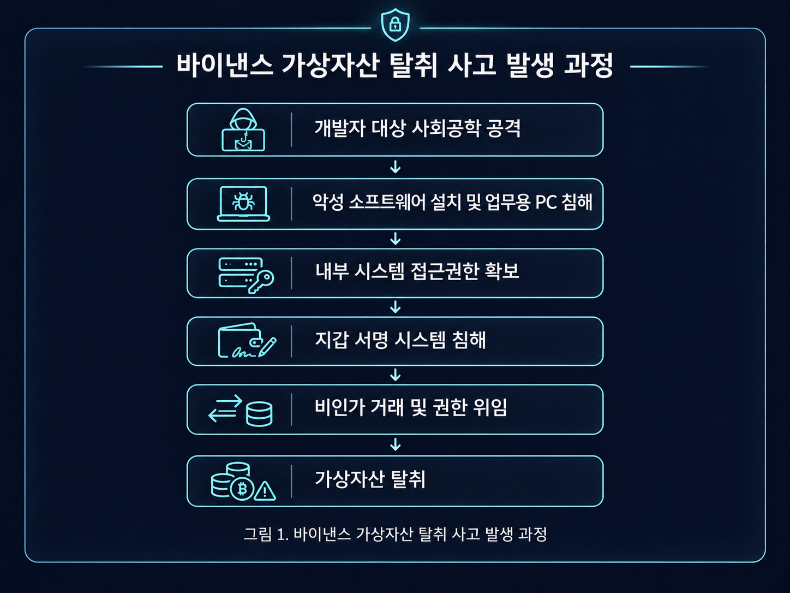

## 1. 사고 개요

2026년 10월 30일(한국시간) 세계 최대 가상자산 거래소인 바이낸스(Binance)에서 약 63억 4,000만 달러(한화 약 8조 5000억원) 규모의 가상자산이 탈취되는 사고가 발생하였다.

미국 연방수사국(FBI)은 해당 사고의 배후로 북한 해킹 조직인 TraderTraitor를 지목하였다. 북한은 해당 공격에 관여했다는 주장을 부인하였다.

이번 사고는 단순히 블록체인 자체의 취약점을 악용한 것이 아니라 사회공학 공격, 악성 소프트웨어, 내부 시스템 침투 및 지갑 서명 권한 악용 등이 복합적으로 이루어진 사고이다.

| 구분 | 내용 |
|---|---|
| 발생일 | 2026년 10월 30일(한국시간) |
| 공격 대상 | Binance |
| 공격 주체 | FBI가 지목한 북한 해킹 조직 TraderTraitor |
| 피해 규모 | 약 63억 4,000만 달러 |
| 피해 자산 | BTC, ETH, XRP, SOL, USDT 등 |
| 주요 원인 | 내부 시스템 침해 및 지갑 서명 권한 악용 |

## 2. 배경지식

### 2-1. 가상자산 지갑

가상자산 지갑은 블록체인에 기록된 자산을 관리하고 거래에 필요한 전자서명을 수행하는 데 사용된다.

가상자산 지갑은 인터넷 연결 여부에 따라 크게 핫월렛과 콜드월렛으로 구분할 수 있다.

| 구분 | 핫월렛(Hot Wallet) | 콜드월렛(Cold Wallet) |
|---|---|---|
| 인터넷 연결 | 연결되어 있음 | 연결되지 않은 환경에서 관리 |
| 거래 편의성 | 높음 | 상대적으로 낮음 |
| 외부 공격 위험 | 상대적으로 높음 | 상대적으로 낮음 |
| 주요 용도 | 빈번한 거래 및 출금 | 장기적인 자산 보관 |

가상자산 거래소는 이용자의 출금 요청을 신속하게 처리하기 위해 핫월렛을 사용한다.

하지만 인터넷과 연결된 시스템이므로 내부 관리 시스템이나 인증 정보가 침해될 경우 자산 탈취로 이어질 수 있다.

### 2-2. 전자서명(Digital Signature)

블록체인에서 가상자산을 전송하기 위해서는 일반적으로 해당 자산을 관리하는 개인키를 기반으로 전자서명을 생성해야 한다.

전자서명은 거래가 정당한 권한을 가진 주체에 의해 승인되었는지 확인하는 역할을 한다.

개인키 자체가 유출되지 않더라도 전자서명을 생성하는 시스템이 공격자에게 악용된다면 승인되지 않은 거래가 발생할 수 있다.

### 2-3. 사회공학 공격(Social Engineering)

사회공학 공격이란 사람의 심리와 신뢰 관계를 악용하여 중요한 정보나 시스템 접근권한을 확보하는 공격 방식이다.

대표적인 예로 정상적인 기업 관계자로 위장하거나 채용 면접을 진행하는 것처럼 속여 악성 프로그램을 설치하도록 유도하는 방식이 있다.

### 2-4. EIP-7702

EIP-7702는 이더리움 계정이 스마트 컨트랙트의 코드를 위임받아 실행할 수 있도록 하는 기능이다.

기존의 일반 사용자 계정에서도 여러 거래를 한 번에 처리하거나 거래 수수료를 다른 주체가 대신 지불하는 등의 기능을 활용할 수 있게 한다.

하지만 악성 스마트 컨트랙트에 실행 권한을 위임하도록 승인할 경우 해당 계정의 자산이 위험에 노출될 수 있다.

이번 사고에서는 EIP-7702 자체의 결함보다는 공격자가 탈취한 서명 권한을 이용하여 해당 기능을 악용한 것이 문제가 되었다.

### 2-5. MPC(Multi-Party Computation)

MPC는 여러 주체가 각자의 비밀 정보를 직접 공개하지 않고 공동으로 연산을 수행하는 기술이다.

가상자산 지갑에서는 완전한 개인키를 하나의 장소에 보관하지 않고 여러 주체가 공동으로 전자서명을 생성하는 방식으로 활용할 수 있다.

하지만 서명 요청과 승인 과정이 침해된다면 MPC를 사용하더라도 승인되지 않은 거래가 발생할 수 있다.

## 3. 사고 발생 과정

바이낸스가 공개한 초기 조사 결과에 따르면 이번 공격은 수개월에 걸쳐 준비된 복합적인 공격이었다.

### 3-1. 개발환경을 대상으로 한 공격

2026년 6월 바이낸스의 개발자가 개발 도구를 설치하는 과정에서 변조된 소프트웨어를 다운로드하는 사건이 발생하였다.

바이낸스 보안팀은 이상 행위를 탐지하고 관련 장비를 교체하였으며 인증 정보도 변경하였다.

그러나 이 과정에서 공격자에게 지갑 인프라 관련 개발자들의 정보가 노출된 것으로 조사되었다.

### 3-2. 가짜 채용 면접을 이용한 사회공학 공격

2026년 9월 공격자는 채용 담당자로 위장하여 바이낸스의 다른 개발자에게 접근하였다.

정상적인 채용 면접처럼 신뢰 관계를 형성한 이후 과제 수행을 명목으로 악성 코드가 포함된 프로그램을 다운로드하도록 유도하였다.

해당 개발자의 업무용 컴퓨터가 침해되었으며 당시 사용 중인 단말기 보안 시스템은 악성코드를 탐지하지 못하였다.

### 3-3. 내부 시스템 침투

공격자는 침해된 개발자 컴퓨터와 내부 AI 도구를 악용하여 다른 개발자의 업무환경에도 영향을 미쳤다.

이 과정에서 내부 시스템에 대한 권한과 인증 정보를 확보하면서 지갑 관리 시스템에 접근할 수 있는 범위가 확대되었다.

### 3-4. 지갑 서명 시스템 악용

공격자는 바이낸스 내부 지갑 서명 시스템에 무단으로 접근하여 정상적인 출금 절차를 거치지 않은 거래를 발생시켰다.

이더리움 지갑에 대해서는 EIP-7702의 권한 위임 기능도 악용하였다.

블록체인에 이미 기록된 권한 위임은 거래소의 출금 서비스를 중단하는 것만으로 취소되지 않았기 때문에 추가적인 대응이 필요하였다.

전체적인 사고 흐름은 다음과 같다.

  

<em>그림 1. 바이낸스 가상자산 탈취 사고 발생 과정</em>

## 4. 피해 규모

바이낸스의 초기 조사 결과에 따르면 사고에 관련된 가상자산의 가치는 약 63억 4,000만 달러이다.

탈취된 자산에는 비트코인(BTC), 이더리움(ETH), 리플(XRP), 솔라나(SOL), 스테이블코인 등이 포함되었다.

공식 조사 자료에 따르면 비트코인 약 18,270개가 공격자에게 전송되었다.

따라서 이번 사고는 비트코인만을 대상으로 한 것이 아니라 여러 블록체인에 걸쳐 다양한 가상자산이 탈취된 사건이다.

## 5. 사고의 근본적인 원인 및 문제점

### 5-1. 개발자 업무환경에 대한 보안 관리

개발자는 내부 시스템에 접근할 수 있는 권한을 가지고 있기 때문에 공격자의 주요 표적이 될 수 있다.

업무용 컴퓨터에서 외부 프로그램이나 검증되지 않은 코드를 실행할 경우 기업 내부 시스템까지 영향을 받을 수 있다.

### 5-2. 악성코드 탐지의 한계

기존 단말기 보안 시스템이 공격에 사용된 악성코드를 탐지하지 못하였다.

이미 알려진 악성코드의 특징만을 기반으로 탐지하는 것이 아니라 프로그램의 비정상적인 실행이나 외부 통신 등을 종합적으로 분석할 필요가 있다.

### 5-3. 내부 시스템 접근 통제 미흡

침해된 개발자 컴퓨터와 내부 AI 도구를 통해 다른 개발환경 및 지갑 관리와 관련된 시스템까지 공격의 영향이 확대되었다.

내부 시스템이라는 이유만으로 접근을 신뢰하는 것이 아니라 모든 접근 요청에 대해 인증과 권한 검증을 수행해야 한다.

### 5-4. 지갑 서명 정책의 한계

정상적인 출금 절차를 거치지 않고도 내부 서명 시스템이 악용될 수 있었다.

따라서 전자서명을 생성할 수 있는지 확인하는 것뿐만 아니라 해당 서명이 어떤 작업을 승인하는 것인지 검증하는 과정도 중요하다.

### 5-5. 긴급 대응 체계의 한계

거래소는 출금 서비스를 중단하였으나 이미 블록체인에 기록된 악성 권한 위임까지 즉시 제거할 수는 없었다.

기존의 출금 차단 방식뿐만 아니라 블록체인상의 권한 위임을 신속하게 취소할 수 있는 대응 절차도 필요하다는 것을 보여준다.

## 6. 사고 대응

### 6-1. 추가 자산 유출 방지

바이낸스는 사고 발생 이후 출금 서비스를 중단하고 악용된 권한을 취소하는 등의 조치를 진행하였다.

또한 외부 가상자산 관련 기업과 협력하여 약 28억 5,000만 달러 규모의 자산을 동결하거나 이동을 차단했다고 발표하였다.

### 6-2. 이용자 자산 보호

바이낸스는 이용자에게 피해를 부담시키지 않고 회사 자금을 이용하여 탈취된 자산을 보충하겠다고 발표하였다.

초기 조사 결과 발표 당시에는 피해가 발생한 종류의 토큰 중 약 98%가 보충되었다고 밝혔다.

다만 거래소가 자체 자금으로 자산을 보충한 것과 실제 공격자에게 탈취된 자산을 회수한 것은 구분해야 한다.

### 6-3. 내부 보안 체계 개선

바이낸스는 다음과 같은 조치를 수행하였다.

- 침해된 지갑 시스템 재구축
- 내부 AI 도구 및 접근 통제 체계 개선
- 침해된 개발자 장비 교체
- 관련 인증 정보 및 토큰 폐기
- 임직원 업무용 장비에 대한 보안 점검
- 지갑 관리 시스템의 위험 통제 강화
- 행위 기반 이상 징후 탐지 강화

### 6-4. 수사기관의 대응

FBI는 이번 공격의 배후로 북한을 지목하고 가상자산 관련 기업에 탈취 자산과 관련된 거래를 차단할 것을 요청하였다.

2026년 11월 23일 미국 법무부는 탈취된 가상자산 중 10억 달러 이상을 회수하기 위한 법적 절차에 착수했다고 발표하였다.

이는 회수를 위한 절차가 진행되고 있다는 의미이며 해당 자산의 최종 반환이 완료되었다는 의미는 아니다.

## 7. 개선 방안

### 7-1. 개발자 보안 교육 및 업무환경 분리

개발자를 대상으로 가짜 채용 면접, 악성 개발 도구 및 피싱에 대한 보안 교육을 실시해야 한다.

개인적인 활동이나 외부 프로그램 실행이 업무용 시스템에 영향을 미치지 않도록 환경을 분리하는 것도 중요하다.

### 7-2. 제로 트러스트(Zero Trust) 적용

기업 내부 시스템에 접근하는 사용자나 장비도 무조건 신뢰하지 않고 지속적으로 인증과 접근권한을 확인해야 한다.

이를 통해 하나의 단말기가 침해되더라도 다른 시스템으로 공격이 확대되는 것을 제한할 수 있다.

### 7-3. 지갑 서명 정책 강화

대규모 자산 이동 및 스마트 컨트랙트 권한 위임과 같은 중요한 작업에는 독립적인 추가 승인 절차를 적용해야 한다.

서명 요청의 목적과 실제 실행 내용을 검증하는 과정도 필요하다.

### 7-4. 핫월렛 자산 규모 제한

서비스 운영에 필요한 자산만 핫월렛에 보관하고 나머지 자산은 상대적으로 외부 공격 위험이 낮은 환경에서 관리해야 한다.

### 7-5. 블록체인 기반 이상 행위 탐지

일반적인 거래소 출금 기록뿐만 아니라 블록체인에 기록되는 권한 위임과 비정상적인 자산 이동도 지속적으로 모니터링해야 한다.

또한 비인가 권한 위임이 발견될 경우 신속하게 취소할 수 있는 절차를 마련해야 한다.

## 8. 느낀 점

이전에 스마트 컨트랙트 보안 사고를 분석하면서 주로 코드 내부의 취약점과 검증 과정의 문제에 집중하였다.

그러나 이번 사고를 조사하면서 블록체인 자체에 문제가 없더라도 개발자의 업무환경이나 거래를 승인하는 시스템이 침해되면 대규모 보안 사고가 발생할 수 있다는 것을 알게 되었다.

특히 개인키를 직접 탈취하지 않고도 서명 시스템과 권한 위임 기능을 악용할 수 있다는 점이 인상 깊었다.

가상자산 거래소의 보안성을 높이기 위해서는 블록체인 기술뿐만 아니라 개발자의 업무환경, 내부 시스템의 접근 통제, 인증 및 승인 절차까지 종합적으로 관리해야 한다고 생각한다.

## 9. 참고자료

- [Binance - Initial Findings and Response Update](https://www.binance.bh/en/blog/community/3229153443759566763)
- [Binance - Security Incident Update](https://www.binance.com/en/support/announcement/detail/d3306d9dca5243548c813b605e1d1751)
- [FBI - North Korea Responsible for $6 Billion+ Binance Attack](https://www.fbi.gov/investigate/cyber/alerts/2026/north-korea-responsible-for-6-billion-binance-attack)
- [미국 법무부 - 바이낸스 탈취 가상자산 회수를 위한 법적 조치](https://www.justice.gov/opa/pr/united-states-files-action-recover-more-1-billion-cryptocurrency-assets-stolen-north-korean)
