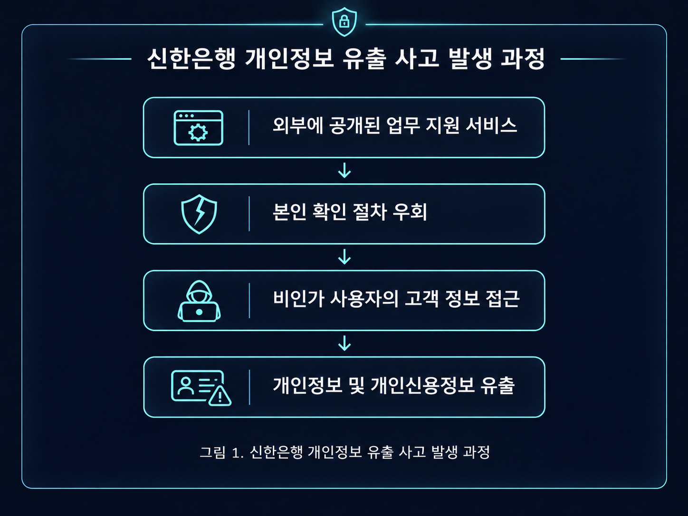

## 1. 사고 개요

2026년 9월 30일 국내 주요 시중은행인 신한은행에서 약 2만 5천 명의 고객 정보가 유출되는 보안 사고가 발생하였다.

이후 KB국민은행, 하나은행, 저축은행, 캐피탈사 등에서도 잇따라 침해사고가 확인되면서 금융권 전반으로 보안 위협이 확대되었다.

특히 이번 사고에서는 인공지능(AI)을 활용한 해킹 도구가 사용되었을 가능성이 제기되었다.

금융위원회는 2026년 10월 14일 기준 총 16개 금융회사에서 침해사고가 확인되었으며, 약 10만 건의 정보가 유출된 것으로 파악했다고 발표하였다.

| 구분 | 내용 |
|---|---|
| 사고 발생 | 2026년 9월 30일 신한은행 침해사고 확인 |
| 공격 대상 | 은행, 저축은행, 캐피탈사 등 |
| 피해 규모 | 10월 14일 기준 금융회사 16곳, 약 10만 건의 정보 유출 |
| 공격 특징 | AI 기반 해킹 도구 활용 가능성 |
| 주요 문제점 | 인증 및 접근 통제 미흡, 보안패치 미적용, 보안관제 체계 미흡 |

다만 모든 금융회사를 동일한 공격자가 공격했는지와 AI가 구체적으로 어떤 방식으로 활용되었는지는 조사 대상에 포함되어 있다.

## 2. 배경지식

### 2-1. AI 기반 해킹

AI 기반 해킹이란 인공지능을 활용하여 공격 대상에 대한 정보 수집, 취약점 탐색 및 공격 과정 등을 자동화하는 것을 의미한다.

기존에는 공격자가 직접 시스템을 분석하고 취약점을 찾아야 했다면, AI를 활용할 경우 이러한 작업의 일부를 자동화할 수 있다.

특히 여러 시스템을 동시에 분석할 수 있어 공격에 필요한 시간을 줄이고 공격 범위를 확대할 수 있다는 특징이 있다.

### 2-2. AI 에이전트(AI Agent)

AI 에이전트란 주어진 목표를 달성하기 위해 작업을 계획하고 필요한 도구를 사용하여 여러 작업을 수행하는 인공지능 시스템이다.

보안 분야에서는 다음과 같은 작업에 활용될 수 있다.

- 시스템 및 서비스 정보 수집
- 소프트웨어 취약점 탐색
- 보안 테스트 자동화
- 보안 로그 및 이상 행위 분석

이러한 기능은 정상적인 보안 점검에도 활용될 수 있지만 공격자가 악용할 경우 해킹 과정의 자동화에도 사용될 수 있다.

### 2-3. 공격표면(Attack Surface)

공격표면이란 공격자가 시스템에 접근하거나 공격을 시도할 수 있는 모든 접점을 의미한다.

대표적인 공격표면에는 다음과 같은 것들이 있다.

- 외부에 공개된 웹사이트
- 관리자 페이지
- API
- 외부 업무 지원 시스템
- 인터넷에 연결된 서버 및 네트워크 장비

공격표면이 넓을수록 공격자가 취약점을 발견할 수 있는 기회가 많아지므로 불필요한 외부 접근을 제한하는 것이 중요하다.

### 2-4. 인증(Authentication)과 인가(Authorization)

인증은 시스템에 접근하는 사용자가 누구인지 확인하는 과정이며, 인가는 해당 사용자가 특정 기능이나 정보에 접근할 권한이 있는지 확인하는 과정이다.

예를 들어 은행의 업무 시스템에서 직원이 로그인하는 과정은 인증에 해당하고, 해당 직원이 특정 고객의 정보를 조회할 권한이 있는지 확인하는 과정은 인가에 해당한다.

정상적으로 인증된 사용자라고 하더라도 모든 정보에 접근할 수 있도록 허용해서는 안 된다.

### 2-5. 다중 인증(MFA)

다중 인증(Multi-Factor Authentication)이란 서로 다른 종류의 인증 요소를 두 개 이상 사용하여 사용자의 신원을 확인하는 방식이다.

예를 들어 비밀번호를 입력한 이후 OTP를 추가로 확인하는 방식이 있다.

다중 인증을 적용하면 비밀번호가 유출되더라도 공격자가 시스템에 접근하기 어려워진다.

### 2-6. 이상거래탐지시스템(FDS)

FDS(Fraud Detection System)는 금융거래 정보를 분석하여 비정상적인 거래를 탐지하는 시스템이다.

평소와 다른 접속 위치, 비정상적인 거래 금액, 반복적인 이체 등 이상 징후를 분석하여 금융사기를 예방하는 데 사용된다.

## 3. 사고 발생 과정

### 3-1. 신한은행 대출모집인 서비스 침해

2026년 9월 30일 신한은행은 대출 관련 고객 정보가 외부로 유출된 사실을 확인하였다.

공격 대상은 일반 고객이 사용하는 모바일 뱅킹 애플리케이션이 아닌 대출모집인이 사용하는 모바일 홈페이지 서비스였다.

해당 서비스는 대출모집인이 자신이 접수한 대출의 처리 현황 등을 확인하기 위해 사용되었다.

### 3-2. 본인 확인 절차 우회

외부 공격자는 대출모집인 서비스의 본인 확인 절차를 우회하여 고객 정보에 무단으로 접근하였다.

은행의 핵심 금융거래 시스템이 아닌 업무 지원 서비스에서도 고객 정보를 처리하고 있었기 때문에 해당 서비스에 대한 침해가 개인정보 유출로 이어졌다.

다만 구체적으로 어떤 코드의 취약점이나 공격 기법이 인증 우회에 사용되었는지는 공개된 자료만으로 정확하게 확인하기 어렵다.

### 3-3. 고객 정보 유출

이번 공격으로 약 2만 5천 명의 고객에 대한 개인·신용정보가 유출되었다.

신한은행은 이번 사고가 일반 고객이 사용하는 모바일 뱅킹 애플리케이션과는 관련이 없다고 설명하였다.

### 3-4. AI 기반 해킹 도구 사용 정황

사고 조사 과정에서 AI 에이전트를 이용하여 해킹 과정을 자동화하는 도구가 사용되었을 가능성을 보여주는 정황이 발견되었다.

AI 기반 해킹 도구는 정보 수집, 취약점 탐색 및 보안 도구 실행 등의 작업을 자동화할 수 있다.

이러한 도구가 악용될 경우 공격자가 여러 금융회사의 시스템을 동시에 분석하고 취약점을 탐색할 수 있다.

다만 AI 해킹 도구의 사용 정황이 발견되었다는 것이 전체 공격 과정이 AI에 의해 수행되었다는 것을 의미하지는 않는다.

### 3-5. 금융권 전반으로 침해사고 확대

신한은행 사고 전후로 KB국민은행, 하나은행, 부산은행 등 다른 금융회사에서도 침해사고가 확인되었다.

이후 저축은행, 캐피탈사, 전자금융업자 등에서도 추가적인 침해사고가 확인되었다.

신한은행 사고의 주요 흐름을 정리하면 다음과 같다.

  

<em>그림 1. 신한은행 개인정보 유출 사고 발생 과정</em>

## 4. 피해 규모

2026년 10월 14일 금융위원회가 발표한 침해사고 발생 금융회사는 다음과 같다.

| 금융업권 | 피해 금융회사 |
|---|---|
| 은행 | 신한은행, KB국민은행, 부산은행, 하나은행 |
| 저축은행 | 예가람저축은행, 웰컴저축은행, DB저축은행, OK저축은행 |
| 여신금융 | 현대캐피탈, 산은캐피탈 |
| 온라인투자연계금융 | PFCT, 모우다 |
| 전자금융 | 브라이트픽스 |
| 가상자산 | 스트리미, 프라뱅 |
| 상호금융 | 새마을금고중앙회 |
| 합계 | 16개사 |

주요 은행의 정보 유출 규모는 다음과 같다.

| 금융회사 | 피해 규모 |
|---|---:|
| 신한은행 | 약 25,000명 |
| KB국민은행 | 119명 |
| 하나은행 | 89명 |

금융권 전체에서는 약 10만 건의 정보가 유출된 것으로 파악되었다.

유출된 정보에는 이름, 연락처, 주민등록번호, 이메일 주소 등이 포함되었다.

다만 10월 14일 금융위원회 발표 당시 계좌 비밀번호나 카드번호와 같이 부정결제에 직접적으로 이용될 수 있는 정보가 유출된 사실은 확인되지 않았다.

개인정보 유출 건수와 실제 피해 인원은 동일하지 않을 수 있으며, 위 수치는 해당 시점의 조사 결과이다.

## 5. 사고의 근본적인 원인 및 문제점

금융위원회는 금융회사 555곳을 대상으로 12개 보안 항목에 대한 점검을 실시하였다.

점검 결과 425개사는 적정하다고 보고하였으며, 130개사는 보완이 필요한 사항이 있다고 보고하였다.

이를 통해 금융권에서 다음과 같은 보안 관리 문제점이 확인되었다.

### 5-1. 인증 및 접근 통제 미흡

신한은행 사고에서는 외부 공격자가 대출모집인 서비스의 본인 확인 절차를 우회하면서 고객 정보에 접근하였다.

또한 금융권 전반에 대한 점검에서도 외부에 공개된 시스템의 인증 및 인가 절차가 충분하지 않은 사례가 발견되었다.

사용자의 인증 여부뿐만 아니라 해당 사용자가 요청한 정보에 접근할 권한이 있는지도 서버에서 확인해야 한다.

### 5-2. 보안패치 미적용

일부 금융회사에서는 최신 보안패치가 적용되지 않은 문제가 확인되었다.

이미 알려진 취약점에 대한 수정 버전이 공개되었음에도 이를 적용하지 않으면 공격자가 해당 취약점을 악용할 가능성이 높아진다.

특히 AI를 활용하면 여러 시스템에 존재하는 알려진 취약점을 빠르게 탐색할 수 있으므로 신속한 보안패치 적용이 더욱 중요하다.

### 5-3. 기술지원이 종료된 시스템 관리 미흡

일부 금융회사에서는 제조사의 기술지원이 종료된 시스템에 대한 관리가 충분하지 않은 것으로 확인되었다.

EOS(End of Support)는 제조사가 해당 제품에 대한 기술지원이나 보안 업데이트 제공을 종료하는 것을 의미한다.

기술지원이 종료된 시스템은 새로운 취약점이 발견되더라도 보안패치를 제공받기 어려울 수 있다.

따라서 금융회사에서는 노후 시스템을 지속적으로 점검하고 교체할 필요가 있다.

### 5-4. 실시간 보안관제 체계 미흡

일부 금융회사에서는 24시간 실시간 보안관제 체계가 충분히 구축되지 않은 것으로 확인되었다.

AI를 활용한 공격은 빠르게 진행될 수 있으므로 비정상적인 접속이나 대량의 개인정보 조회 등을 신속하게 탐지할 수 있어야 한다.

공격 발생 이후 뒤늦게 대응하는 것보다 공격 과정에서 이상 징후를 발견하고 차단하는 것이 중요하다.

### 5-5. 공격표면 관리 미흡

금융회사에는 모바일 뱅킹이나 인터넷 뱅킹 외에도 업무 지원 서비스, 외부 협력업체용 시스템 등 다양한 서비스가 존재한다.

핵심 금융 시스템의 보안에만 집중할 경우 상대적으로 중요도가 낮다고 판단한 시스템이 보안 사각지대가 될 수 있다.

이번 신한은행 사고에서도 일반 고객용 뱅킹 시스템이 아닌 대출모집인 서비스에서 개인정보가 유출되었다.

따라서 외부에서 접근할 수 있는 모든 시스템을 보안 관리 대상에 포함해야 한다.

### 5-6. 금융회사 간 위협정보 공유의 한계

금융당국의 조사 결과 기존에는 금융당국과 금융보안원이 파악한 위협정보를 금융회사에 전달하고 있었지만, 개별 금융회사가 자체적으로 발견한 위협정보를 공동으로 공유하는 체계는 충분하지 않았다.

한 금융회사에서 발견된 공격 유형이 다른 금융회사에서도 사용될 수 있으므로 신속한 위협정보 공유가 필요하다.

위 문제점은 금융권 전체에 대한 점검에서 발견된 사항이며, 모든 문제가 신한은행의 직접적인 사고 원인으로 확인된 것은 아니다.

## 6. 사고 대응

### 6-1. 금융당국의 긴급 대응

금융위원회와 금융감독원은 사고 발생 이후 긴급 대응회의를 개최하고 금융보안원 등과 함께 사고 조사에 착수하였다.

침해사고가 발생한 금융회사에는 현장 조사 인력이 파견되었으며 공격에 사용된 IP 주소 등의 위협정보가 다른 금융회사에도 공유되었다.

### 6-2. 금융회사 보안 강화

금융당국은 추가 피해를 방지하기 위해 금융회사에 다음과 같은 조치를 요구하였다.

- 공격에 사용된 IP 주소 차단
- 취약한 시스템에 대한 보안패치 적용
- 침해된 서비스의 중단 및 점검
- 외부에 노출된 시스템에 대한 접근 통제 강화
- 다중 인증 적용 확대
- 노후 장비 교체
- 보안관제 인력 및 설비 확충

### 6-3. 금융권 전수점검

금융당국은 은행뿐만 아니라 저축은행, 보험사, 증권사, 카드사, 전자금융업자 등을 대상으로 긴급 보안점검을 실시하였다.

2026년 10월 14일에는 점검 결과와 함께 금융권 보안 관리체계 강화 방안을 발표하였다.

주요 내용은 다음과 같다.

- 외부에 노출된 모든 시스템에 대한 관리 강화
- 금융회사 간 해킹 위협정보 공유 확대
- AI 기반 취약점 점검 체계 구축 추진
- 취약점 점검 및 평가 주기 확대 추진
- 중소형 금융회사를 위한 공동 보안관제 체계 구축 검토
- 경영진의 보안 관리 책임 강화 검토

### 6-4. 개인정보 유출에 따른 2차 피해 예방

개인정보가 유출되면 직접적인 금융거래 정보가 유출되지 않았더라도 보이스피싱이나 스미싱 등의 추가적인 피해가 발생할 수 있다.

금융당국은 2026년 10월 6일 소비자경보 주의 단계를 발령하고 금융회사에 피해 고객 보호조치를 강화하도록 요구하였다.

- 개인정보 유출 고객 대상 전담 상담 창구 운영
- 이상거래탐지시스템(FDS) 강화
- 비정상적인 고액 이체 발생 시 본인 확인
- 금융거래 안심차단서비스 안내
- 개인정보노출자 사고예방시스템 안내

이후 추가적인 금융권 개인정보 유출 사고가 확인됨에 따라 특별대응기간을 2026년 12월 말까지 연장하기로 하였다.

## 7. 개선 방안

### 7-1. 인증과 인가 검증 강화

모든 외부 접근 요청에 대해 사용자 인증과 접근권한 검증을 수행해야 한다.

특히 업무 지원 서비스에서도 사용자가 자신의 업무와 관련된 고객 정보만 조회할 수 있도록 접근권한을 제한해야 한다.

사용자 화면에서 특정 기능을 숨기는 것만으로는 충분하지 않으며 서버에서도 접근권한을 반드시 검증해야 한다.

### 7-2. 공격표면 최소화

업무 수행에 필요하지 않은 외부 접속 서비스는 제거하거나 접근을 제한해야 한다.

관리자 페이지와 업무 전용 서비스는 허용된 IP 주소 또는 별도의 인증 절차를 통해서만 접근할 수 있도록 구성하는 것이 좋다.

또한 외부에 노출된 시스템의 목록을 지속적으로 관리해야 한다.

### 7-3. 보안패치 및 노후 시스템 관리

금융회사가 사용하는 소프트웨어와 장비의 버전 및 보안 업데이트 상태를 지속적으로 확인해야 한다.

보안 취약점이 공개되면 위험도를 평가하여 신속하게 패치를 적용하고 기술지원이 종료된 장비는 교체해야 한다.

### 7-4. IDS/IPS를 활용한 실시간 탐지 및 대응

IDS는 비정상적인 트래픽이나 공격 징후를 탐지하며, IPS는 탐지된 공격을 차단하는 역할을 한다.

금융회사는 IDS/IPS와 같은 보안 시스템을 활용하여 비정상적인 접근 요청이나 공격 시도를 지속적으로 확인해야 한다.

또한 데이터베이스의 대량 조회 등 정상적인 인증 정보를 악용한 공격도 탐지할 수 있도록 다양한 보안 로그를 함께 분석해야 한다.

### 7-5. AI 기반 보안 위협 대응

AI를 활용한 공격에 대응하기 위해 방어 측에서도 AI를 활용한 보안 기술을 도입할 수 있다.

예를 들어 비정상적인 트래픽 분석, 취약점 탐색, 보안 로그 분석 등에 AI를 활용하면 빠르게 변화하는 공격에 대응하는 데 도움이 될 수 있다.

다만 AI의 판단에만 의존하기보다는 보안 전문가의 검토와 기존 보안 체계를 함께 활용해야 한다.

### 7-6. 지속적인 모의해킹 및 취약점 점검

정기적인 보안점검뿐만 아니라 새로운 서비스가 추가되거나 시스템이 변경될 때에도 취약점 점검을 수행해야 한다.

특히 외부에 공개된 업무 지원 서비스와 API 등 기존 보안점검에서 제외될 수 있는 영역도 함께 점검해야 한다.

발견된 취약점은 실제 수정 여부까지 확인하여 동일한 문제가 반복되지 않도록 해야 한다.

### 7-7. 금융회사 간 위협정보 공유 강화

개별 금융회사에서 발견한 공격 유형, 악성 IP 주소, 취약점 정보 등을 다른 금융회사와 신속하게 공유해야 한다.

이를 통해 한 금융회사에서 발생한 보안 사고가 다른 금융회사에서도 반복되는 것을 예방할 수 있다.

## 8. 느낀 점

이번 사고를 조사하면서 금융권처럼 높은 수준의 보안이 요구되는 분야에서도 인증 및 접근 통제, 보안패치와 같은 기본적인 보안 관리가 충분하지 않으면 대규모 사고가 발생할 수 있다는 것을 알게 되었다.

특히 일반 고객이 사용하는 뱅킹 시스템이 아닌 업무 지원 서비스에서 고객 정보가 유출되었다는 점이 인상 깊었다.

중요한 시스템에만 집중하여 보안을 강화하는 것이 아니라 외부에서 접근할 수 있는 모든 서비스에 대해 보안 점검이 이루어져야 한다고 생각한다.

또한 AI의 발전으로 인해 취약점을 탐색하고 공격을 수행하는 속도가 빨라질 수 있으므로 기존의 정기적인 보안점검만으로는 대응에 한계가 있을 것이라고 생각한다.

이전에 IDS/IPS와 OWASP Top 10의 접근 통제에 대해 공부하면서 공격 탐지와 접근권한 검증의 중요성을 배웠는데, 이번 사고를 통해 이러한 보안 기술과 원칙이 실제 금융 시스템에서도 중요하게 작용한다는 것을 알 수 있었다.

새로운 보안 기술을 도입하는 것도 중요하지만 기본적인 보안 수칙을 준수하고 발견된 취약점을 지속적으로 개선하는 것이 보안 사고 예방의 기본이라고 생각한다.

## 9. 참고자료

- [금융위원회 - 금융권 긴급 상황대응 회의 개최, 2026.10.02](https://fsc.go.kr/po010101/87869)
- [금융위원회 - 금융권 침해사고 재발방지를 위한 금융보안 관리체계 강화, 2026.10.14](https://www.fsc.go.kr/no010101/87927)
- [금융위원회 - 금융권 개인정보 유출 관련 소비자경보 발령](https://www.fsc.go.kr/no010101/87882)
- [금융위원회 - 금융권 개인정보 유출 관련 특별대응기간 연장](https://www.fsc.go.kr/po010101/88098)
- [연합뉴스 - 대출모집인 전용 서비스 뚫렸다, 신한은행 보안 허점 노출](https://www.yna.co.kr/view/AKR20261001145451002)
- [연합뉴스 - 신한은행 해킹에 AI 동원됐나](https://www.yna.co.kr/view/AKR20261002042351017)
- [뉴시스 - 금융사 해킹 16곳으로 확대, 10만건 유출](https://m.newsis.com/view/NISX20261014_0003826251)
