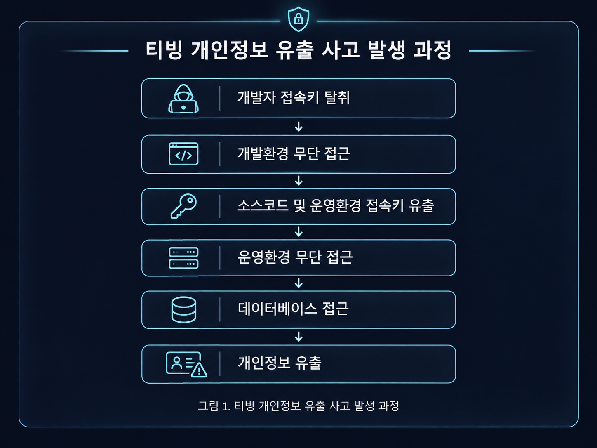

## 1. 사고 개요

2026년 5월 국내 OTT 서비스인 티빙(TVING)에서 대규모 개인정보 유출 사고가 발생하였다.

공격자는 개발자의 접속키를 탈취하여 내부 시스템에 침투하였으며, 개발 프로젝트의 소스코드와 이용자 정보를 외부로 유출하였다.

2026년 9월 3일 과학기술정보통신부는 민관합동조사단의 조사 결과를 발표하였다. 조사 결과 접속키 관리, 접근권한 통제, 이상 징후 탐지, 취약점 개선 등 정보보호 관리체계 전반에서 문제점이 발견되었다.

| 구분 | 내용 |
|---|---|
| 사고 발생 | 2026년 5월 |
| 사고 인지 | 2026년 5월 30일 |
| 침해사고 신고 | 2026년 6월 1일 |
| 조사 결과 발표 | 2026년 9월 3일 |
| 피해 규모 | 약 3,954만 개의 계정 정보 및 개발 프로젝트 361건 |
| 주요 원인 | 접속키 탈취 및 관리 미흡, 접근 통제 미흡 |

## 2. 배경지식

### 2-1. 접속키(Access Key)

접속키란 특정 시스템이나 서비스에 접근하기 위해 사용하는 인증 정보이다.

올바른 접속키를 가지고 있으면 해당 키에 부여된 권한에 따라 시스템에 접근하거나 데이터를 조회할 수 있다.

따라서 접속키가 외부로 유출될 경우 공격자가 정상적인 사용자처럼 시스템에 접근할 수 있다.

### 2-2. 하드코딩(Hard Coding)

하드코딩이란 프로그램에서 사용하는 값을 소스코드에 직접 작성하는 것을 의미한다.

예를 들어 다음과 같이 접속키를 코드에 직접 작성하는 경우가 있다.

```python
access_key = "example_access_key"
```

이러한 방식은 소스코드가 외부로 유출되었을 때 접속키까지 함께 노출될 수 있다는 문제가 있다.

따라서 중요한 인증 정보는 소스코드에 직접 작성하지 않고 별도의 비밀정보 관리 시스템 등을 통해 안전하게 관리해야 한다.

### 2-3. 개발환경과 운영환경

- **개발환경:** 개발자가 프로그램을 작성하고 기능을 테스트하는 환경
- **운영환경:** 실제 이용자에게 서비스를 제공하고 이용자의 데이터를 처리하는 환경

개발환경에서 보안 사고가 발생하더라도 실제 이용자 정보가 저장된 운영환경까지 영향을 받지 않도록 두 환경을 분리하여 관리해야 한다.

### 2-4. 최소 권한 원칙(Principle of Least Privilege)

최소 권한 원칙이란 사용자나 프로그램에 업무를 수행하는 데 필요한 최소한의 권한만 부여하는 것을 의미한다.

접속키가 탈취되더라도 공격자가 접근할 수 있는 시스템과 데이터의 범위를 제한할 수 있다.

## 3. 사고 발생 과정

### 3-1. 개발환경 접속키 탈취

공격자는 티빙 개발자가 보유하고 있던 개발환경 접속키를 탈취하여 내부 시스템에 무단으로 접근하였다.

이후 소스코드가 포함된 개발 프로젝트 361건을 유출하였다.

다만 최초 접속키가 구체적으로 어떤 방식으로 탈취되었는지는 밝혀지지 않았다.

### 3-2. 운영환경 접속키 확보

유출된 개발 프로젝트에는 운영환경에 접근할 수 있는 접속키가 포함되어 있었다.

공격자는 이를 이용하여 실제 이용자 정보를 처리하는 운영환경에 접근할 수 있었다.

### 3-3. 데이터베이스 접근 및 개인정보 유출

공격자는 운영환경에 접근한 이후 데이터베이스에 접속하여 이용자 정보를 조회하였다.

첫 번째 정보 유출 시도에서는 데이터베이스 서버에 과부하가 발생하면서 이상 징후가 탐지되었고, 티빙은 이를 차단하였다.

그러나 이후 추가적인 공격이 발생하면서 대규모 이용자 정보가 외부로 유출되었다.

전체적인 사고 흐름은 다음과 같다.

<p align="center">
  
</p>

<p align="center"><em>그림 1. 티빙 개인정보 유출 사고 발생 과정</em></p>

## 4. 피해 규모

민관합동조사단이 확인한 유출 규모는 다음과 같다.

| 구분 | 유출 규모 |
|---|---:|
| 활성화 계정 | 약 2,206만 개 |
| 비활성화 계정 | 약 1,737만 개 |
| 테스트 계정 | 약 11만 개 |
| 전체 계정 | 약 3,954만 개 |
| 개발 프로젝트 | 361건 |

동일한 이용자가 여러 개의 계정을 보유할 수 있으므로 유출된 계정 수와 실제 피해 인원은 차이가 있다.

유출된 개인정보에는 이름, 생년월일, 휴대전화 번호, 이메일 주소, 이용자 ID 등이 포함되었다.

또한 이용자 인증체계, 콘텐츠 추천 및 검색 알고리즘, 결제 관리 등의 기술자산도 함께 유출되었다.

## 5. 사고의 근본적인 원인 및 문제점

### 5-1. 접속키 관리 미흡

소스코드에 운영환경 접속키가 포함되어 있었기 때문에 개발환경이 침해된 이후 운영환경까지 접근할 수 있었다.

중요한 인증 정보를 소스코드에 직접 작성하거나 안전하지 않은 방식으로 공유하는 것은 정보 유출의 위험을 높인다.

### 5-2. 접근권한 통제 미흡

개발환경에서 확보한 정보를 이용하여 운영환경까지 접근할 수 있었다는 점에서 시스템 간 접근 통제가 충분하지 않았음을 알 수 있다.

각 시스템의 접근권한을 분리하고 인증 정보가 유출되더라도 접근 가능한 범위를 제한해야 한다.

### 5-3. 이상 행위 탐지 미흡

첫 번째 공격에서는 데이터베이스 과부하를 통해 이상 징후를 발견하였으나 이후 발생한 추가 공격으로 정보가 유출되었다.

서버의 자원 사용량뿐만 아니라 비정상적인 데이터 조회, 접속 위치, 외부 데이터 전송량 등도 함께 모니터링해야 한다.

### 5-4. 기존 취약점에 대한 개선 미흡

2024년에 실시한 모의해킹에서도 접속키 하드코딩 문제가 발견되었으나 충분한 개선이 이루어지지 않았다.

취약점을 발견하는 것에 그치지 않고 실제로 수정되었는지 확인하는 과정이 필요하다.

### 5-5. 침해사고 대응 및 신고 지연

사고가 내부 정보보안팀에 전달된 시점으로부터 24시간이 지난 이후에 한국인터넷진흥원에 신고가 이루어졌다.

침해사고가 발생하였을 때 신속하게 상황을 공유하고 대응할 수 있는 체계가 필요하다.

## 6. 사고 대응

티빙은 데이터베이스에서 발생한 이상 징후를 확인한 후 관련 작업을 차단하였다.

2026년 6월 1일 한국인터넷진흥원(KISA)에 침해사고를 신고하였으며, 이후 과학기술정보통신부와 한국인터넷진흥원 등이 사고 조사에 착수하였다.

민관합동조사단은 다음과 같은 조사를 진행하였다.

- 개발자 단말기 포렌식 분석
- 내부 시스템 및 보안장비의 접속 기록 분석
- 공격자의 침투 경로 확인
- 개인정보 및 기술자산 유출 규모 확인
- 정보보호 관리체계 점검

2026년 9월 3일 조사 결과가 발표되었으며 접속키 관리, 접근 통제 및 이상 행위 탐지 체계 등에 대한 개선이 요구되었다.

## 7. 개선 방안

- 접속키를 소스코드에 직접 작성하지 않고 별도의 비밀정보 관리 시스템을 이용한다.
- 접속키의 유효기간과 접근권한을 제한하고 주기적으로 교체한다.
- 개발환경과 운영환경을 분리한다.
- 최소 권한 원칙을 적용하여 불필요한 접근권한을 제거한다.
- 데이터베이스의 비정상적인 조회 및 대량의 데이터 전송을 탐지한다.
- 모의해킹에서 발견된 취약점이 실제로 개선되었는지 확인한다.
- 침해사고 발생 시 신속하게 대응하고 신고할 수 있는 절차를 마련한다.
- 서비스 이용 목적이 종료되어 보유할 필요가 없는 개인정보는 관련 법령에 따라 파기한다.

## 8. 느낀 점

이번 사고를 조사하면서 새로운 취약점을 발견하는 것만큼 이미 발견된 취약점을 제대로 개선하는 것도 중요하다는 것을 알게 되었다.

특히 하나의 접속키가 유출된 것이 개발환경뿐만 아니라 운영환경과 이용자의 개인정보에까지 영향을 미쳤다는 점이 인상 깊었다.

이전에 OWASP Top 10의 접근 통제에 대해 공부하면서 사용자 인증뿐만 아니라 접근권한을 확인하는 과정도 중요하다는 것을 배웠는데, 이번 사고를 통해 이러한 접근 통제가 실제 서비스에서도 중요하게 작용한다는 것을 알 수 있었다.

보안 시스템을 구축하는 것에 그치지 않고 지속적인 점검과 취약점 개선이 이루어져야 한다고 생각한다.

## 9. 참고자료

- [과학기술정보통신부 - 티빙(TVING) 침해사고 조사결과 발표](https://m.korea.kr/briefing/pressReleaseView.do?newsId=156780136)
- [대한민국 정책브리핑 - 티빙 민관합동조사단 조사결과 주요내용](https://www.korea.kr/briefing/policyBriefingView.do?newsId=156780195)
- [연합뉴스 - 티빙 보안관리 총체적 부실](https://www.yna.co.kr/view/AKR20260903132000017)
